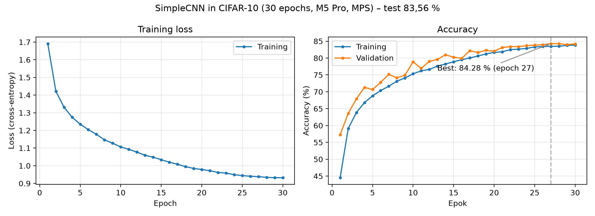

# Neural Network Inference Optimization

Comparing neural network architectures for image classification and measuring how much inference performance can be gained through optimization (quantization, pruning, graph compilation and optimized inference backends), and what it costs in accuracy.

> **Status:** 🚧 Work in progress (week 2 of 12). SimpleCNN baseline trained (83.56% test accuracy). Results, graphs and conclusions are added as each phase is completed.

---

## 1. Project overview

**Goal:** For each architecture and optimization technique, measure:

| Metric | Unit | How |
| --- | --- | --- |
| Accuracy (top-1), before and after optimization | % | Full CIFAR-10 test set (10,000 images) |
| Inference latency | ms | Median and p95 over 300 runs, after warm-up |
| Throughput | images/s | Batch size 1 and 32 |
| RAM usage | MB | Peak RSS (`psutil`) |
| GPU memory usage | MB | CUDA: `torch.cuda.max_memory_allocated` / NVML; MPS: `torch.mps.driver_allocated_memory` (unified memory) |
| Model size | MB | File size on disk |

The final result is a **trade-off analysis** (Pareto front) between accuracy and speed: *for a given latency budget, which architecture and optimization give the highest accuracy?*

**Research questions**

1. How much faster do models become with FP16, INT8, pruning and optimized backends?
2. How much accuracy is lost for each technique?
3. Do different architectures (small CNN, classic CNN, mobile CNN) benefit differently from the same optimization?
4. When does an optimization look good on paper (fewer parameters) without making inference faster?
5. How does an Apple Silicon GPU (MPS) compare with an NVIDIA T4 for the same models?

### Project plan (12 weeks)

| Week | Phase | Milestone | Report | Status |
| --- | --- | --- | --- | --- |
| 1–2 | PyTorch and baseline | Own CNN trained on CIFAR-10; stable benchmark script | Report 1: baseline and warm-up | 🚧 |
| 3–4 | Architectures | ResNet-18 and MobileNetV2 compared on accuracy and model size | Report 2: architectures | ⬜ |
| 5–6 | Quantization | FP32 vs FP16 (GPU) and FP32 vs INT8 (CPU) | Report 3: quantization | ⬜ |
| 7–8 | Pruning | Structured pruning + fine-tuning evaluated | Report 4: pruning | ⬜ |
| 9–10 | ONNX and CUDA | PyTorch, `torch.compile`, ONNX Runtime and TensorRT compared | Report 5: backends | ⬜ |
| 11 | Docker and reproducibility | Project runs on another machine from this README | – | ⬜ |
| 12 | GitHub and presentation | Results, graphs, final report and demo published | Final report | ⬜ |

---

## 2. Dataset and architectures

**Dataset:** [CIFAR-10](https://www.cs.toronto.edu/~kriz/cifar.html), 10 classes, 60,000 colour images (32×32).

| Split | Images | Used for |
| --- | --- | --- |
| Train | 45,000 | Training; INT8 calibration data |
| Validation | 5,000 | Selecting the best checkpoint |
| Test | 10,000 | All reported accuracy numbers |

The train/validation split is fixed with seed 42. Training images are augmented (random crop with 4-pixel padding, horizontal flip); validation and test images are not.

**Architectures**

| Model | Source | Parameters (10-class head) | Input | Why it is included |
| --- | --- | --- | --- | --- |
| SimpleCNN (own) | `src/models.py` | 0.62 M | 32×32 | Baseline built from scratch: 3 conv blocks + 2 linear layers |
| ResNet-18 | torchvision | 11.2 M | 224×224 | Classic CNN with residual connections |
| MobileNetV2 | torchvision | 2.2 M | 224×224 | Designed for mobile: depthwise separable convolutions |
| *(optional)* ResNet-50, MobileNetV3, EfficientNet-B0, DeiT-Tiny | torchvision / timm | 5–26 M | 224×224 | Extensions if time allows |

---

## 3. Training configuration

| Setting | SimpleCNN | ResNet-18 / MobileNetV2 |
| --- | --- | --- |
| Initialization | Random | ImageNet pre-trained, new 10-class head |
| Input resolution | 32×32 | 224×224 |
| Normalization | CIFAR-10 mean/std | ImageNet mean/std |
| Loss | Cross-entropy, label smoothing 0.1 | Cross-entropy, label smoothing 0.1 |
| Optimizer | AdamW, weight decay 0.05 | AdamW, weight decay 0.05 |
| Learning rate | 1e-3, cosine schedule | 1e-4, cosine schedule |
| Epochs | 30 | 5 |
| Batch size | 128 | 128 |
| Augmentation | Random crop (padding 4), horizontal flip | Random crop, horizontal flip |
| Checkpoint | Best validation accuracy | Best validation accuracy |
| Seed | 42 | 42 |
| Trained on | MacBook Pro M5 Pro (MPS), ~4 s/epoch | TODO |

**Training results**

| Model | Epochs | Best validation acc. | Test acc. | Parameters | Size (FP32) |
| --- | --- | --- | --- | --- | --- |
| SimpleCNN | 15 | 81.22% | 81.00% | 620,810 | 2.38 MB |
| SimpleCNN | 30 | 84.28% (epoch 27) | **83.56%** | 620,810 | 2.38 MB |
| ResNet-18 | | | | | |
| MobileNetV2 | | | | | |

The 30-epoch SimpleCNN is used as the baseline in all further experiments.



---

## 4. Optimization methods

| Method | Device | What it does | Expected effect |
| --- | --- | --- | --- |
| FP16 | GPU (CUDA, MPS) | Weights and activations in 16-bit floats; uses Tensor Cores on NVIDIA | Lower latency and memory, almost no accuracy loss |
| `torch.compile` | GPU (CUDA) | Compiles the model graph and fuses operations | Lower latency |
| ONNX Runtime | CPU + GPU | Exports the model to ONNX and runs it in an optimized runtime | Lower latency |
| INT8 static quantization | CPU | 8-bit integers, calibrated on training data | ~4× smaller model, faster on CPU, small accuracy loss |
| Unstructured pruning | CPU + GPU | Sets the smallest weights to zero | Fewer non-zero weights, but **no** speed-up (tensors are still dense) |
| Structured pruning | CPU + GPU | Removes whole channels, then fine-tunes | Smaller and faster model |
| TensorRT FP16 | GPU (CUDA) | NVIDIA's inference engine: layer fusion and kernel selection | Largest GPU speed-up |
| *(optional)* Core ML | Apple Neural Engine | ONNX Runtime with `CoreMLExecutionProvider` | Low latency on Apple Silicon |

### Measurement methodology

Correct benchmarking matters more than any single optimization. All measurements follow these rules:

- **Warm-up before measuring.** The first runs include one-time costs (GPU initialization, kernel loading and shader compilation, cuDNN autotuning, memory allocation, clock ramp-up, compilation). Warm-up iterations are run and discarded; the number is chosen from a warm-up experiment.
- **Synchronize the GPU.** GPU calls are asynchronous, so `torch.cuda.synchronize()` (CUDA) or `torch.mps.synchronize()` (MPS) is called before and after every timed call. Without it, only the kernel launch time is measured.
- **Batch size 1 and 32.** Batch 1 represents real-time latency; batch 32 represents throughput.
- **Inference only.** Data is loaded to the device before timing starts; data loading is never part of latency or throughput.
- **Environments reported separately.** Results from M5 Pro CPU, M5 Pro MPS and Colab CUDA are kept apart, and speed-up is always computed against the baseline in the same environment.
- **Fixed CPU threads.** The number of threads is set to the number of performance cores.
- **One process per variant,** so memory measurements and caches do not leak between runs.

---

## 5. Benchmark results

> TODO: generated from `results/results_*.csv` by `src/analyze.py`.

### CPU (Apple M5 Pro)

| Model | Variant | Accuracy (%) | Latency b=1 (ms) | Latency b=32 (ms) | Throughput b=32 (img/s) | RAM (MB) | Size (MB) |
| --- | --- | --- | --- | --- | --- | --- | --- |
| | | | | | | | |

### Apple GPU (M5 Pro, MPS)

| Model | Variant | Accuracy (%) | Latency b=1 (ms) | Latency b=32 (ms) | Throughput b=32 (img/s) | Memory (MB) | Size (MB) |
| --- | --- | --- | --- | --- | --- | --- | --- |
| | | | | | | | |

### NVIDIA GPU (Tesla T4, Google Colab)

| Model | Variant | Accuracy (%) | Latency b=1 (ms) | Latency b=32 (ms) | Throughput b=32 (img/s) | GPU mem (MB) | Size (MB) |
| --- | --- | --- | --- | --- | --- | --- | --- |
| | | | | | | | |

---

## 6. Performance graphs

> TODO: graphs are saved in `figures/`.

- Accuracy vs latency with Pareto front (one per environment)
- Accuracy before and after optimization
- Speed-up per technique and architecture
- Throughput for batch size 1 and 32
- Model size per variant
- Memory usage
- Warm-up effect: latency per iteration from the first call
- Apple GPU (MPS) vs NVIDIA T4 for the same models

<!-- Example:  -->

---

## 7. Hardware specifications

| | CPU and Apple GPU measurements | NVIDIA GPU measurements |
| --- | --- | --- |
| Machine | MacBook Pro, Apple M5 Pro | Google Colab |
| CPU | Apple M5 Pro (arm64), 15 cores: 5 Super + 10 Performance | (see `results/hardware_colab.txt`) |
| GPU | Apple M5 Pro GPU, 16 cores (MPS) | NVIDIA Tesla T4, 16 GB |
| Memory | 24 GB unified (shared by CPU and GPU) | (see `results/hardware_colab.txt`) |
| OS | macOS 26.7.3 | Linux (Colab) |
| Python | 3.11 | (Colab default) |
| PyTorch | 2.15.0 | 2.11.0 + CUDA 13.0 |
| ONNX Runtime | 1.31.1 | TODO |

Full details: `results/hardware_m5.txt` and `results/hardware_colab_*.txt`.

---

## 8. Conclusions and limitations

> TODO: written in week 12.

**Known limitations (so far)**

- Results come from three environments (M5 Pro CPU, M5 Pro MPS, Colab CUDA) and are not compared directly as speed-ups across environments.
- Colab's free tier may assign different GPUs between sessions; only results from the same GPU type are compared.
- PyTorch versions differ between the Mac and Colab.
- Apple Silicon uses unified memory, so "GPU memory" on MPS is not directly comparable with dedicated GPU memory on the T4.
- Laptop clock speed varies with temperature and power mode; measurements are repeated 3–5 times.
- Only one dataset (CIFAR-10) is used.

---

## Repository structure

```text
nn-optimization-project/
├── configs/            # one config per experiment
├── data/               # CIFAR-10 (downloaded automatically, not in Git)
├── models/             # saved weights: .pt, .onnx, .engine (not in Git)
├── notebooks/          # exploration; finished code is moved to src/
├── src/
│   ├── utils.py        # seed, device selection, synchronize
│   ├── check_setup.py  # sanity check of the environment
│   ├── data.py         # transforms, train/val/test split, data loaders
│   ├── models.py       # SimpleCNN and build_model
│   ├── train.py        # training
│   ├── benchmark.py    # latency, throughput, memory, size
│   ├── optimize/       # quantize.py, prune.py, export.py
│   └── analyze.py      # tables and graphs
├── results/            # results_*.csv, train_*.csv, hardware_*.txt
├── figures/            # graphs
├── report/             # LaTeX reports
└── requirements-m5.txt
```

## How to reproduce

### Local (Mac with Apple Silicon)

```bash
git clone https://github.com/alicewesterberg/nn-optimization-project.git
cd nn-optimization-project
conda create -n nnopt python=3.11 -y
conda activate nnopt
pip install -r requirements-m5.txt
python -m src.check_setup
```

### Google Colab (NVIDIA GPU)

1. Runtime → Change runtime type → **T4 GPU**.
2. Run:

```python
from google.colab import drive
drive.mount('/content/drive')
!git clone https://github.com/alicewesterberg/nn-optimization-project.git
%cd nn-optimization-project
!pip install -q timm onnx onnxruntime-gpu pynvml torch-pruning
!python -m src.check_setup
```

### Running the experiments

```bash
# Train the SimpleCNN baseline (~2 min on M5 Pro)
python -m src.train --model simple_cnn --epochs 30 --num-workers 0
```

> TODO: add commands as the scripts are written, e.g.

```bash
python -m src.benchmark --model simple_cnn --variant fp32 --device cpu --batch-sizes 1,32
python -m src.analyze
```

### Docker

> TODO: added in week 11.

---

## Author

Alice Westerberg · MSc Computer Science and Engineering (AI/ML), Lund University (LTH)
[GitHub](https://github.com/alicewesterberg) · [LinkedIn](https://linkedin.com/in/alice-westerberg)
